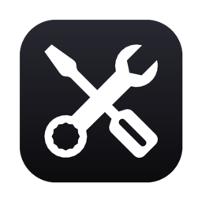
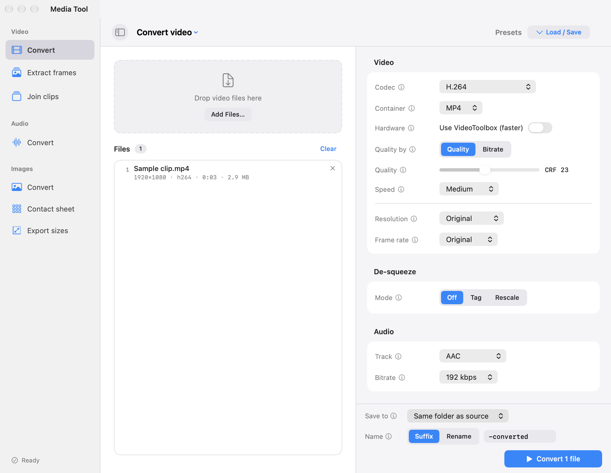

<p align="center">
  
</p>

<h1 align="center">MediaTool</h1>

<p align="center">A native macOS workspace for video, audio, and image conversion.</p>



*Modern interface, rendered directly from the app's SwiftUI views.*

MediaTool puts FFmpeg and ImageMagick behind a SwiftUI interface. Add files, choose an operation,
review the generated command, and process a batch through a sequential queue. Media processing
runs locally using tools installed on your Mac.

## Features

| Media | Operations |
| --- | --- |
| **Video** | Convert MP4, MKV, MOV, and WebM; encode H.264, HEVC, VP9, or AV1; copy video streams; extract frames; join clips. |
| **Audio** | Convert or extract MP3, M4A, WAV, FLAC, and Opus; normalize loudness; adjust gain, sample rate, and channels. |
| **Images** | Convert PNG, JPEG, WebP, AVIF, HEIC, TIFF, GIF, and BMP; combine images into a PDF; create contact sheets; export multiple sizes. |

- **Video controls:** quality or bitrate, VideoToolbox hardware encoding for H.264 and HEVC,
  resolution, frame rate, audio tracks, trimming, crop, rotation, flips, playback speed, and
  anamorphic de-squeeze through aspect metadata or rescaling.
- **Image controls:** resize, quality, crop, rotation, flips, brightness, contrast, saturation,
  grayscale, metadata removal, borders, canvas padding, and logo watermarks with a live preview.
- **Batch workflow:** drag and drop, input metadata, built-in and saved presets, output naming,
  command previews, live progress, cancellation, and Reveal in Finder.
- **macOS integration:** menu bar queue controls, Dock progress, and completion notifications
  when authorized, with a Dock bounce as a fallback.
- **Appearance:** Modern and Classic interfaces, independent accents, and System, Light, or Dark
  appearance in Modern.

## Install the release

Download the universal DMG from [GitHub Releases](https://github.com/Ajtn05/MediaTool/releases/latest),
open it, and drag **MediaTool.app** to **Applications**. Eject the DMG, then open the app from
Applications. The download supports Apple silicon and Intel Macs running macOS 13 or later.
Install the processing tools listed below; they are not included in the DMG.

Release builds are ad-hoc signed and are not notarized. If macOS blocks the first launch, see
[Apple's instructions for opening an app you trust](https://support.apple.com/en-us/102445).

## Requirements

- macOS 13 Ventura or later.
- Swift 5.9 or later, provided by Xcode or Apple's Command Line Tools.
- FFmpeg, including `ffprobe`, for video and audio operations.
- ImageMagick 7 (`magick`) for image operations and app icon generation.

With [Homebrew](https://brew.sh) installed:

```sh
brew install ffmpeg imagemagick
```

Image-to-PDF output also requires Ghostscript:

```sh
brew install ghostscript
```

If the Swift toolchain is missing, install Apple's Command Line Tools:

```sh
xcode-select --install
```

The app checks common Homebrew and MacPorts locations, then the inherited `PATH`.
After installing a missing tool, use **Re-check** in the app or in **Settings → Command-line Tools**.

## Build and run

Run these commands from the repository root. The project uses Swift Package Manager and has no
external Swift package dependencies. A full Xcode installation is optional.

For development:

```sh
swift run MediaTool
```

To build a double-clickable application:

```sh
./scripts/build-app.sh
open dist/MediaTool.app
```

The script builds a release executable, generates the app icon from `assets/icon.svg`, assembles
`dist/MediaTool.app`, and applies an ad-hoc signature for local use. If `iconutil` cannot pack the
iconset, it uses the Python 3 helper in `scripts/`. The resulting app is ad-hoc signed and is not
notarized.

To build the universal DMG and its SHA-256 checksum:

```sh
./scripts/build-dmg.sh
```

This compiles both `arm64` and `x86_64`, verifies the app signature, and creates
`dist/MediaTool-1.0.0-universal.dmg` with an Applications shortcut and installation instructions.
The image is checked with `hdiutil verify` before it replaces the previous DMG.
Use `APP_VERSION=1.0.1 ./scripts/build-dmg.sh` to build another version.

Pushing a tag such as `v1.0.0` runs the release workflow: it builds the universal DMG, sets the app
version from the tag, and publishes the DMG and checksum to GitHub Releases. Add release notes in
`docs/releases/<tag>.md`; otherwise GitHub generates the notes from the repository history.

To compile the release executable without assembling an app bundle:

```sh
swift build --configuration release
```

## Using the app

1. Choose **Video**, **Audio**, or **Images** and an operation in the sidebar or toolbar menu.
2. Drop compatible files into the workspace, or use **Add Files…**.
3. Select a preset or adjust the settings. The info buttons explain individual controls.
4. Choose the output folder and a filename suffix or replacement name.
5. Review the command preview, then start the operation. Follow progress in the queue, menu bar,
   or Dock, and reveal finished files in Finder.

Outputs go beside their sources by default, with a `-converted` suffix. Existing output files
at the selected paths can be replaced. Review the destination and naming settings before
repeating a conversion.

Presets and appearance preferences are stored locally in `UserDefaults`.

## Project structure

```text
Sources/MediaTool/
├── App/                 App entry point and conversion workflow state
├── Models/              Formats, conversion settings, jobs, presets, and metadata
├── Services/            Command building, processes, queue, probing, and system integration
└── Views/
    ├── Appearance/      Theme tokens and native window appearance
    ├── Components/      Reusable controls, helpers, help text, and logo shapes
    ├── Settings/        App preferences and media operation settings
    └── *.swift          Workspace, file import, previews, output controls, and queue UI
assets/                  Source SVG artwork for app and menu bar icons
scripts/                 App bundle builder and ICNS fallback helper
docs/                    UI style guide and README images
.github/workflows/       macOS release-build checks
```

The app and menu bar artwork use Bootstrap Icons' [Tools](https://icons.getbootstrap.com/icons/tools/)
icon under the [MIT license](assets/LICENSE.bootstrap-icons), included in the app bundle.

`AppState` turns staged files and settings into jobs. `CommandBuilder` creates argument arrays
shared by execution and command previews; media commands run directly through `Process`, without
a shell. `JobQueue` runs one job at a time, and `ProgressParser` interprets FFmpeg's progress
stream. `MediaProbe` reads input metadata through `ffprobe`, while `PreviewService` renders image
previews through ImageMagick.

Generated binaries, Swift build caches, editor metadata, credentials, and local-only files are
excluded by `.gitignore`.

## Development

Follow the existing separation between models, services, and views. Keep command construction in
`CommandBuilder` and shared UI styling in the theme and components. See the
[style guide](docs/STYLE_GUIDE.md) for layout, appearance, and control conventions.

Swift files use four-space indentation and the checked-in `.swift-format` configuration.
With a toolchain that includes `swift-format`:

```sh
# Apply formatting.
xcrun swift-format format --in-place --recursive Package.swift Sources

# Check formatting without modifying files.
xcrun swift-format lint --strict --recursive Package.swift Sources
```

Before submitting changes, run the relevant checks:

```sh
bash -n scripts/build-app.sh scripts/build-dmg.sh
swift build --configuration release
```

GitHub Actions runs the script syntax check and release build on macOS for pushes and pull
requests. There is currently no automated test suite. For UI changes, also check Modern in light
and dark appearances, Classic, narrow windows, and the affected media operations.

## Limitations and troubleshooting

- **Available formats and encoders depend on your installed tools.** MediaTool does not bundle
  FFmpeg, ImageMagick, Ghostscript, or codec libraries.
- **Joining clips uses FFmpeg's concat filter.** Inputs need compatible video dimensions and
  stream properties. When audio is enabled, every clip must contain an audio stream.
- **PDF output requires Ghostscript** and an ImageMagick policy that permits PDF writing.
- **Contact sheets need a font for labels.** The app looks for common macOS font files and omits
  labels if none is available.
- **Notifications require an app bundle and permission.** Running with `swift run` uses the Dock
  fallback instead.
